<div align="center">

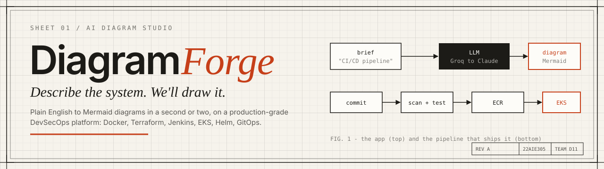

**An AI diagram studio, built and shipped like a production system.**

Turn a plain-English description into a clean, editable, shareable [Mermaid](https://mermaid.js.org) diagram, on a platform that runs the same DevSecOps workflow a real engineering team would.

[](https://github.com/Mahakisore7/Diagram-Ops/actions/workflows/pr.yml)
[](LICENSE)


[Quick start](#quick-start) · [Architecture](#architecture) · [User flows](#user-flows) · [UML](#uml-and-data-model) · [CI/CD](#cicd-pipeline) · [API](#api-reference) · [Deploy](#deploying-to-aws) · [Security](#security) · [Docs](#documentation)

</div>

---

## Contents

1. [What it is](#what-it-is)
2. [Screenshots](#screenshots)
3. [Features](#features)
4. [Architecture](#architecture)
5. [User flows](#user-flows)
6. [UML and data model](#uml-and-data-model)
7. [CI/CD pipeline](#cicd-pipeline)
8. [Tech stack](#tech-stack)
9. [Quick start](#quick-start)
10. [Configuration](#configuration)
11. [API reference](#api-reference)
12. [Project structure](#project-structure)
13. [Testing](#testing)
14. [Deploying to AWS](#deploying-to-aws)
15. [Cost control](#cost-control)
16. [Security](#security)
17. [Roadmap and status](#roadmap-and-status)
18. [Documentation](#documentation)
19. [Contributing](#contributing)
20. [Team and acknowledgements](#team-and-acknowledgements)
21. [License](#license)

---

## What it is

DiagramForge has two halves, and both are the point.

**The product** is a diagram studio. You describe a process, a system or a data model in plain English; an LLM returns Mermaid source; the app renders it live, lets you edit the source, and saves it to a versioned library you can search, tag, share by link and export.

**The platform** is everything around it: containers, Terraform-managed AWS infrastructure, a Jenkins pipeline with five security gates, a private image registry, a Kubernetes cluster and a Helm chart. The app is deliberately small so that the engineering around it can be studied end to end.

> **Guiding principle:** keep the app simple, make the platform serious.

## Screenshots

<table>
  <tr>
    <td width="50%">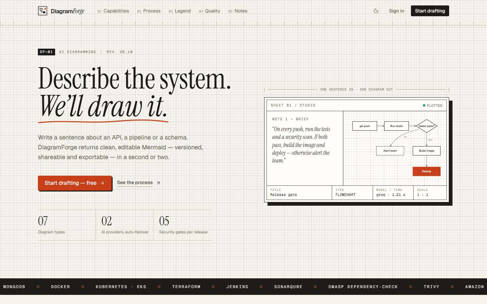<br/><sub><b>Landing.</b> The hero draws a diagram from a typed brief.</sub></td>
    <td width="50%">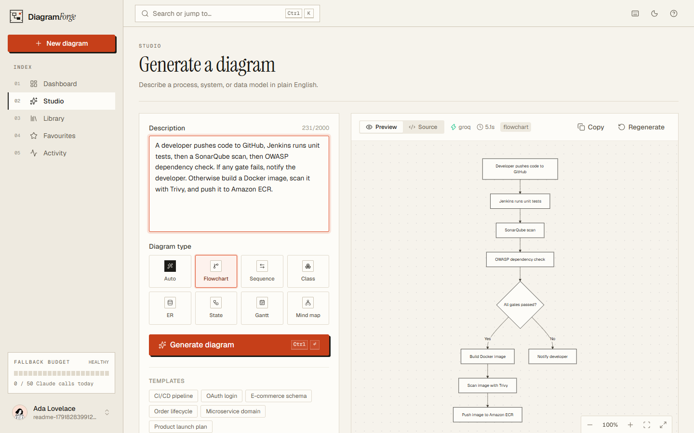<br/><sub><b>Studio.</b> Plain English in, a rendered flowchart out, with live source.</sub></td>
  </tr>
  <tr>
    <td width="50%">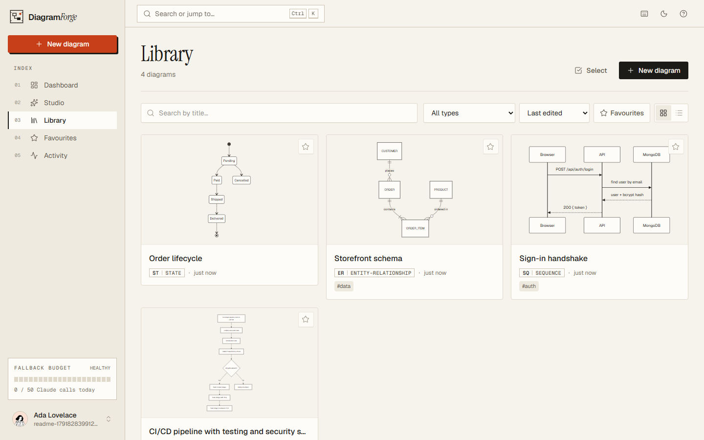<br/><sub><b>Library.</b> Search, filter by type or tag, favourites, duplicates.</sub></td>
    <td width="50%">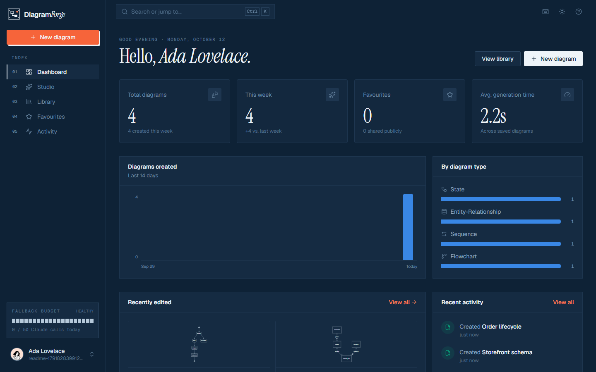<br/><sub><b>Dashboard, dark theme.</b> The same design in "cyanotype".</sub></td>
  </tr>
  <tr>
    <td colspan="2">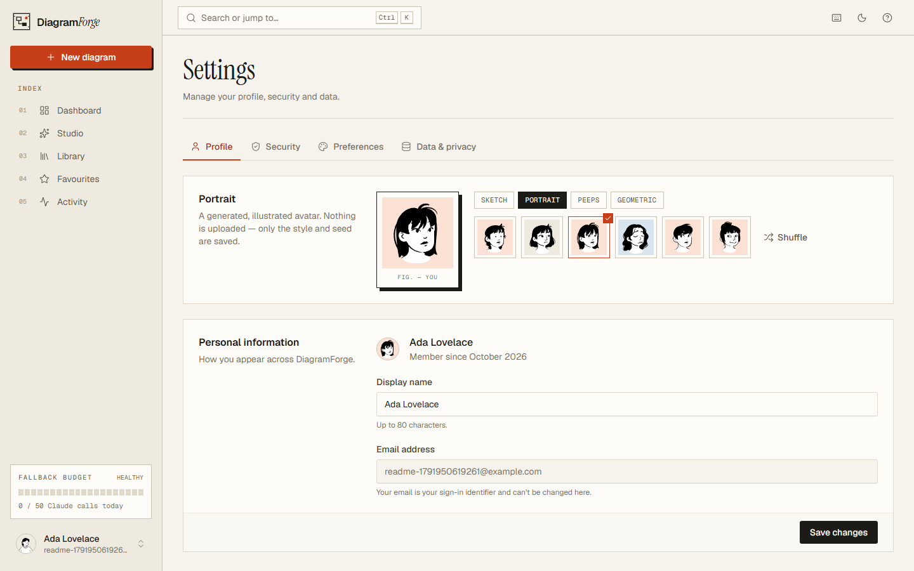<br/><sub><b>Avatar studio.</b> Four drawing styles (Sketch, Portrait, Peeps, Geometric), six candidates per page, shuffle for more. Only <code>{ style, seed }</code> is stored; the image is drawn in the browser, so nothing is uploaded or fetched from a third party.</sub></td>
  </tr>
</table>

## Features

### Product

| Area | What you get |
|---|---|
| **Generation** | Plain English to Mermaid in about a second or two. Seven diagram types (flowchart, sequence, class, ER, state, Gantt, mind map) or *Auto*. Starter templates. |
| **Reliability** | Fast free provider first (Groq), automatic failover to Claude, with a **daily cap on paid calls** checked before every call. Clear `429` / `503` errors instead of crashes. |
| **Editor** | Source and preview side by side, syntax-aware code editor, pan and zoom canvas, unsaved-changes guard. |
| **Library** | Search, type filter, tags, favourites, duplicate, sort, pagination. Last 20 versions of every diagram are kept. |
| **Sharing** | Revocable public links using unguessable tokens. Shared pages are read-only and rate-limited. |
| **Account** | Register, sign in, profile, illustrated avatars generated in the browser, password change, **full data export** and **account deletion**. |
| **Audit** | Activity log of sign-ins, saves, shares and deletes, kept for 90 days. |
| **Design** | Light "drafting paper" and dark "cyanotype" themes, keyboard shortcuts, command palette, responsive down to phone width. |

### Platform

| Area | What you get |
|---|---|
| **Containers** | Multi-stage, non-root images: backend about 70 MB, frontend (nginx) about 28 MB. |
| **Infrastructure as code** | Terraform modules for the VPC, IAM, security groups, Jenkins server, ECR and the EKS cluster, with remote state in S3 and DynamoDB locking. |
| **CI** | Jenkins multibranch pipelines using a shared library: tests, SonarQube quality gate, OWASP Dependency-Check, Docker build, Trivy image scan, push to ECR. |
| **Delivery** | A Helm chart with probes, resource limits, optional autoscaling, a MongoDB StatefulSet with a persistent volume and an ALB Ingress. |
| **Cost control** | Budget alerts, on-demand cluster, one-command deploy and teardown scripts. |

## Architecture

### System context

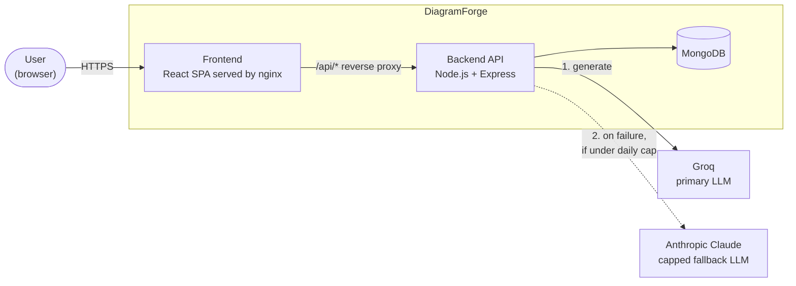

### Runtime on AWS

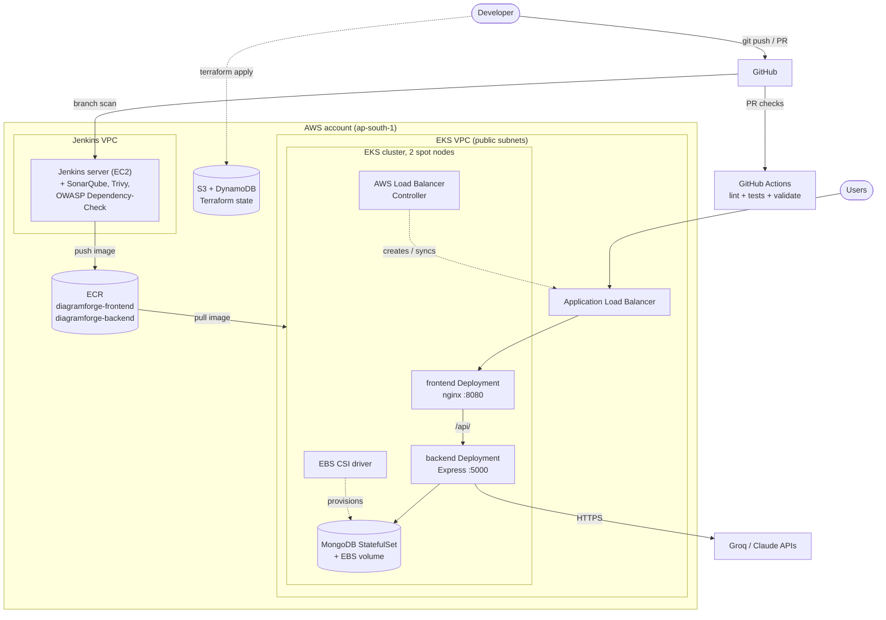

### Request path

The browser only ever talks to **one origin**. nginx serves the single-page app and proxies `/api/` to the backend, so there is no CORS surface and the Ingress needs a single rule (see [ADR-0007](docs/adr/0007-nginx-api-proxy.md)).

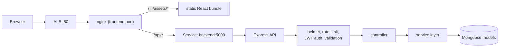

## User flows

### Journey

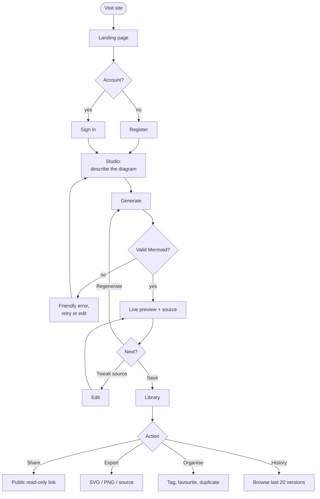

### Generating a diagram, with failover and the cost cap

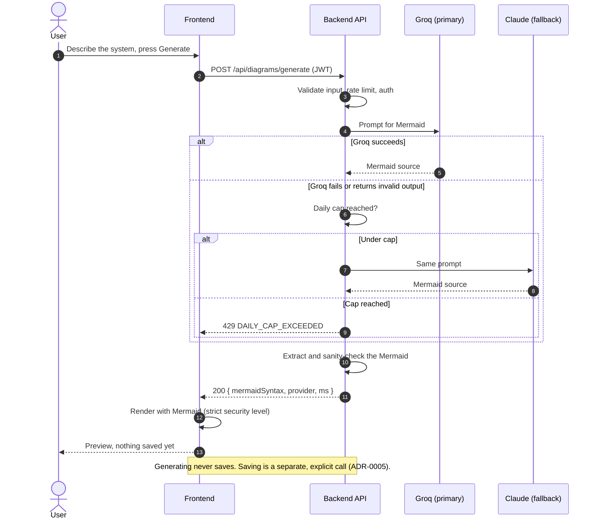

### Sign-in

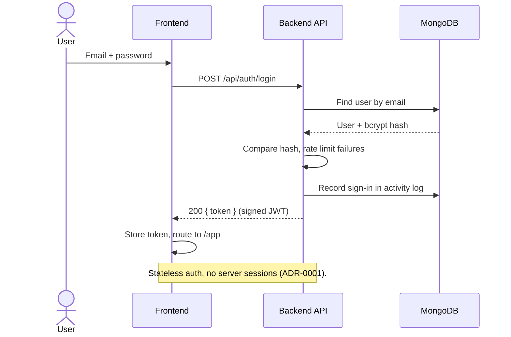

### Sharing a diagram

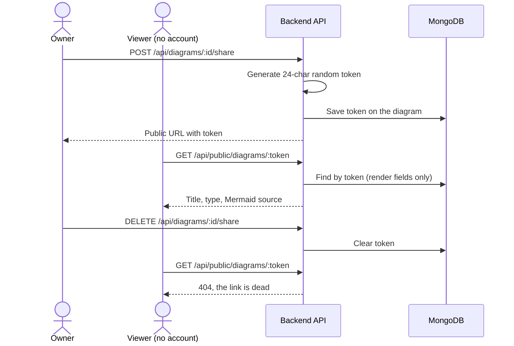

### Diagram lifecycle

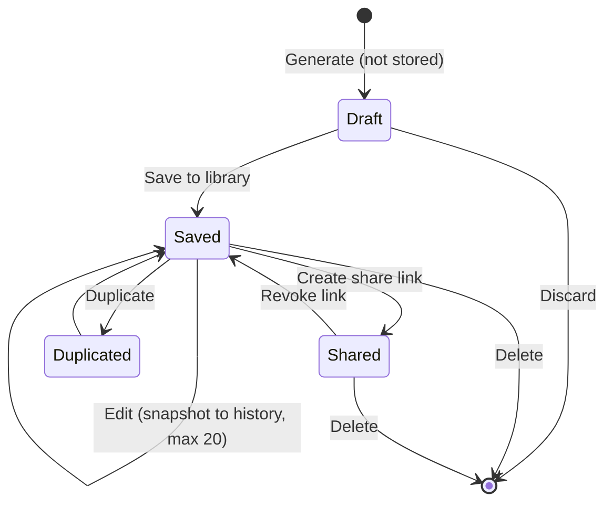

## UML and data model

### Entity relationships

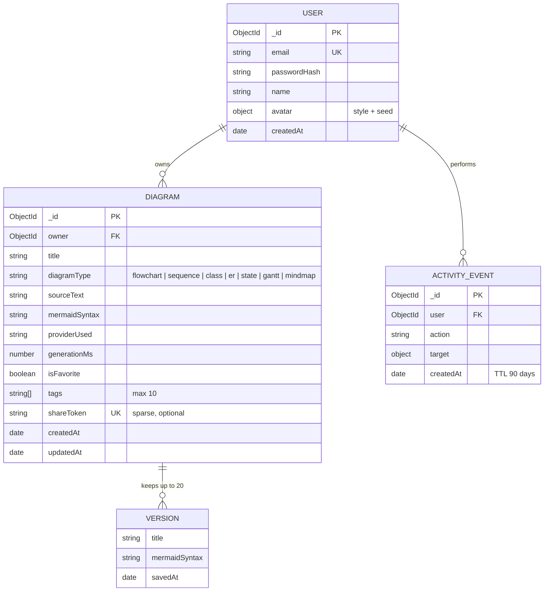

### Backend structure

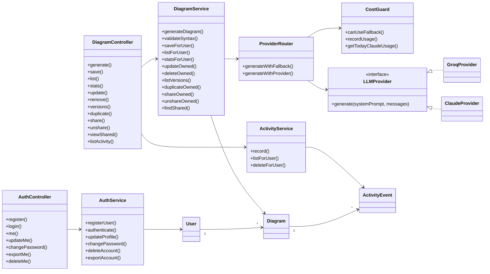

### Use cases

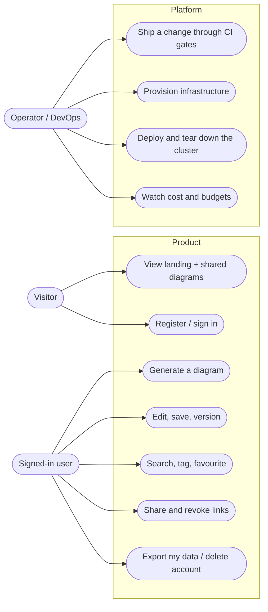

## CI/CD pipeline

Two independent Jenkins multibranch pipelines (backend and frontend) share one library of steps. Each run starts by checking whether anything relevant changed, so a docs-only commit does not trigger a full scan. Pass `FORCE_BUILD` to override.

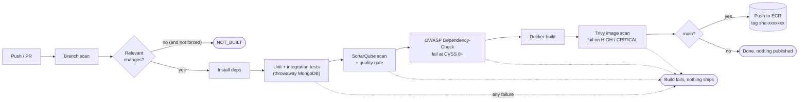

| Gate | Tool | Stops the build when |
|---|---|---|
| Correctness | Jest, Supertest, real MongoDB | any test fails |
| Code quality | SonarQube (Community) | the quality gate is not `OK` |
| Dependencies | OWASP Dependency-Check | a dependency has CVSS 8.0 or higher |
| Image | Trivy | the image has a HIGH or CRITICAL finding |
| PR hygiene | GitHub Actions | lint, tests or Terraform / Helm validation fail |

Pipelines resolve the AWS account and ECR registry **at run time** from the Jenkins server's IAM role, so the same Jenkinsfiles work in any account. The shared library lives in its own repository: [`diagramforge-jenkins-shared-library`](https://github.com/Mahakisore7/diagramforge-jenkins-shared-library).

## Tech stack

| Layer | Technology |
|---|---|
| **Frontend** | React 19, Vite 6, Tailwind CSS v4, Mermaid 11, Motion, React Router, DiceBear (avatars, rendered client-side) |
| **Backend** | Node.js 24, Express 4, Mongoose 8, JWT, bcryptjs, helmet, express-rate-limit |
| **Data** | MongoDB 7 (TTL index for the audit log, sparse unique index for share tokens) |
| **AI** | Groq (`openai/gpt-oss-120b`) primary, Anthropic Claude fallback, provider interface so more can be added |
| **Containers** | Docker multi-stage builds, nginx-unprivileged, Docker Compose for local |
| **IaC** | Terraform (S3 + DynamoDB remote state), Helm |
| **CI** | Jenkins (shared library), GitHub Actions, SonarQube, OWASP Dependency-Check, Trivy |
| **Cloud** | AWS: EC2, VPC, IAM and IRSA, ECR, EKS, EBS, ALB, Budgets |
| **Testing** | Jest, Supertest, real MongoDB integration tests, Playwright browser checks |

## Quick start

### Prerequisites

Docker with Compose. For real AI generation, a free [Groq API key](https://console.groq.com); an Anthropic key is optional (it only powers the fallback).

### Run everything locally

```bash
git clone https://github.com/Mahakisore7/Diagram-Ops.git
cd Diagram-Ops/application
cp .env.example .env     # then set JWT_SECRET and GROQ_API_KEY (and optionally ANTHROPIC_API_KEY)
docker compose up --build
```

| Service | URL |
|---|---|
| App | http://localhost:5173 |
| API (dev convenience only) | http://localhost:5000 |

The real path is always `http://localhost:5173/api/...` through nginx.

> **Windows note:** Docker Compose gives environment variables in your shell priority over `.env`. If a stale `ANTHROPIC_API_KEY` is set in Windows, remove it or the stack will use that instead of the file.

### Develop without Docker

```bash
# terminal 1: MongoDB
docker run -d --name mongo -p 27017:27017 mongo:7

# terminal 2: backend
cd application/backend
cp .env.example .env
npm ci && npm run dev

# terminal 3: frontend
cd application/frontend
npm ci && npm run dev
```

## Configuration

Backend settings come from environment variables (see [`application/backend/.env.example`](application/backend/.env.example)).

| Variable | Default | Purpose |
|---|---|---|
| `MONGO_URI` | none | MongoDB connection string |
| `JWT_SECRET` | none | Signing key for tokens. Generate with `node -e "console.log(require('crypto').randomBytes(48).toString('hex'))"` |
| `JWT_EXPIRES_IN` | `24h` | Token lifetime |
| `DEFAULT_LLM_PROVIDER` | `groq` | Primary provider |
| `FALLBACK_LLM_PROVIDER` | `claude` | Used if the primary fails |
| `GROQ_API_KEY`, `GROQ_MODEL` | none, `openai/gpt-oss-120b` | Groq credentials and model |
| `ANTHROPIC_API_KEY`, `ANTHROPIC_MODEL` | none, `claude-sonnet-5` | Claude credentials and model |
| `DAILY_CLAUDE_CALL_CAP` | `50` | Hard daily limit on paid fallback calls |
| `RATE_LIMIT_WINDOW_MS`, `RATE_LIMIT_MAX` | `60000`, `30` | Global rate limit |

Never commit real keys. `.env` files are git-ignored, and the Helm chart takes secrets only at install time.

## API reference

All routes are under `/api`. Routes marked **auth** need `Authorization: Bearer <token>`. Errors use one envelope: `{ "error": { "code": "...", "message": "..." } }`.

| Method | Path | Auth | Purpose |
|---|---|---|---|
| `POST` | `/auth/register` | no | Create an account |
| `POST` | `/auth/login` | no | Sign in, receive a JWT |
| `GET` | `/auth/me` | yes | Current profile |
| `PATCH` | `/auth/me` | yes | Update name and avatar |
| `GET` | `/auth/me/export` | yes | Download all your data |
| `POST` | `/auth/change-password` | yes | Change password |
| `DELETE` | `/auth/me` | yes | Delete the account and its data |
| `POST` | `/diagrams/generate` | yes | Generate Mermaid from text (does not save) |
| `POST` | `/diagrams` | yes | Save a diagram |
| `GET` | `/diagrams` | yes | List with search, type, tag, favourite, sort, paging |
| `GET` | `/diagrams/stats` | yes | Counts for the dashboard |
| `GET` | `/diagrams/:id` | yes | One diagram |
| `PATCH` | `/diagrams/:id` | yes | Edit (snapshots history) |
| `DELETE` | `/diagrams/:id` | yes | Delete |
| `GET` | `/diagrams/:id/versions` | yes | Version history |
| `POST` | `/diagrams/:id/duplicate` | yes | Duplicate |
| `POST` / `DELETE` | `/diagrams/:id/share` | yes | Create or revoke a public link |
| `GET` | `/activity` | yes | Your audit log |
| `GET` | `/provider-status` | yes | Remaining paid-fallback budget |
| `GET` | `/public/diagrams/:token` | no | Read a shared diagram (rate limited) |
| `GET` | `/healthz`, `/readyz` | no | Liveness and readiness (outside `/api`) |

Someone else's resource returns `404`, not `403`, so IDs cannot be probed ([ADR-0006](docs/adr/0006-404-not-403-for-unowned-resources.md)). The full contract and error catalogue are in the [functional specification](docs/functional-spec.md).

## Project structure

```text
Diagram-Ops/
├── application/
│   ├── backend/            Express API, models, services, providers, tests
│   ├── frontend/           React SPA, nginx config, Dockerfile
│   └── docker-compose.yaml Local three-tier stack
├── charts/three-tier-app/  Helm chart (dev and prod values)
├── infrastructure/
│   ├── bootstrap/          Terraform state bucket + lock table
│   ├── modules/            vpc, iam-role, security-group
│   ├── jenkins-server/     Jenkins EC2 + network + IAM
│   ├── ecr/                Image repositories + policies
│   └── eks-cluster/        EKS, node group, OIDC, IRSA roles, EBS CSI
├── ci/jenkins/             Jenkinsfile.backend, Jenkinsfile.frontend
├── jenkins-config/         Jenkins Configuration as Code
├── scripts/                deploy-dev.ps1, teardown-dev.ps1
├── docs/                   Specs, design, ADRs, phase guides, report
└── .github/workflows/      PR checks
```

## Testing

```bash
cd application/backend
docker run -d --name mongo -p 27017:27017 mongo:7    # integration tests need a real MongoDB
npm test                                             # 9 suites, 77 tests
```

| Level | What it covers |
|---|---|
| **Unit** | Cost guard, sticky retry, JSON extraction, rate limiting, provider fallback and error mapping, auth, ownership rules |
| **Integration** | The whole HTTP stack against a real MongoDB: auth, CRUD, versions, share links, activity log, account export and deletion |
| **Browser** | Playwright and Puppeteer runs through register, generate, save, share, library and settings in light and dark, plus mobile width |
| **Pipeline** | Every pull request runs the same tests in GitHub Actions and again in Jenkins |

## Deploying to AWS

The cluster is expensive to leave running, so the model is **create it, verify, destroy it**. Everything is reproducible from code.

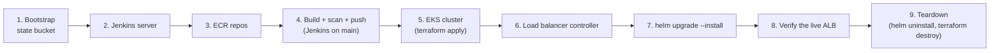

```bash
# 1-3: one-time foundations (per AWS account)
cd infrastructure/bootstrap      && terraform init && terraform apply
cd ../jenkins-server             && terraform init -backend-config=backend.hcl && terraform apply
cd ../ecr                        && terraform init -backend-config=backend.hcl && terraform apply

# 4: push to main; Jenkins builds, scans and pushes sha-tagged images to ECR

# 5-6: the cluster (about 15 minutes)
cd ../eks-cluster                && terraform init -backend-config=backend.hcl && terraform apply
aws eks update-kubeconfig --region ap-south-1 --name diagramforge-cluster
kubectl apply -f lb-controller-service-account.yaml
helm repo add eks https://aws.github.io/eks-charts && helm repo update
helm install aws-load-balancer-controller eks/aws-load-balancer-controller -n kube-system \
  --set clusterName=diagramforge-cluster --set serviceAccount.create=false \
  --set serviceAccount.name=aws-load-balancer-controller --set region=ap-south-1 --set vpcId=<vpc-id>

# 7: deploy the app. Applies the default gp3 StorageClass, then installs the chart,
#    reading secrets from application/.env (never printed)
./scripts/deploy-dev.ps1

# 9: remove everything that bills
./scripts/teardown-dev.ps1
```

Terraform values live in git-ignored `terraform.tfvars` and `backend.hcl` files, with `*.example` templates checked in.

### Helm chart

`charts/three-tier-app` renders a frontend Deployment and Service, a backend Deployment, Service and optional HorizontalPodAutoscaler, a MongoDB StatefulSet with a volume claim and a headless Service, a Secret, and an ALB Ingress. Probes use the real `/healthz` and `/readyz` endpoints. Services are named exactly `backend` and `frontend` because the frontend's nginx proxies to `backend:5000`.

```bash
helm lint charts/three-tier-app -f charts/three-tier-app/values-dev.yaml \
  --set global.registry=<account>.dkr.ecr.ap-south-1.amazonaws.com \
  --set frontend.image.tag=sha-x --set backend.image.tag=sha-x \
  --set secrets.jwtSecret=x --set secrets.groqApiKey=x --set secrets.anthropicApiKey=x
```

## Cost control

Built to stay inside a limited credit balance.

| Resource | Cost while running | Policy |
|---|---|---|
| EKS control plane | about $0.10 / hour | Created only for a deploy-and-verify session, then destroyed |
| Worker nodes (2 spot) | about $0.05 to $0.10 / hour | Same lifecycle as the cluster |
| Application Load Balancer | about $0.03 / hour | Deleted by `helm uninstall` before the cluster goes |
| Jenkins EC2 | about $0.10 / hour | **Stopped** whenever no build is running |
| ECR, S3 state, DynamoDB locks | cents per month | Always on |
| No NAT gateway | $0 | Public subnets only, so the largest hidden cost never appears |

AWS Budgets alerts fire at **$25, $50 and $75**. Always run `./scripts/teardown-dev.ps1` and stop the Jenkins instance when finished, then confirm in the console that no load balancers or volumes remain.

## Security

Defence is layered from the code to the cluster.

| Layer | Controls |
|---|---|
| **Authentication** | bcrypt password hashing, signed JWTs with expiry, rate-limited auth routes, one uniform error for a bad email or password |
| **Authorisation** | Every query is scoped to the owner; others' resources return `404` |
| **Input** | Strict validation, regex-escaped search, capped lengths and tag counts, Mermaid rendered at its strict security level |
| **HTTP** | `helmet`, a strict Content-Security-Policy (`script-src 'self'`), per-route rate limits, no inline scripts |
| **Sharing** | Unguessable 144-bit tokens, revocable, read-only, render fields only, separately rate-limited |
| **Privacy** | Export and delete your own data; the activity log expires after 90 days |
| **Supply chain** | Dependency audit and OWASP gate, Trivy image scan, committed lockfiles, `npm audit` clean for production dependencies |
| **Containers** | Multi-stage builds, non-root users, no npm or build tools in the backend runtime image |
| **Infrastructure** | Least-privilege IAM, IRSA instead of static keys, admin access locked to an IP, no secrets in git, encrypted remote state |
| **Cost abuse** | The paid LLM fallback has a hard daily cap checked **before** each call |

### Known gaps, stated honestly

| Gap | Plan |
|---|---|
| Kubernetes Secrets are base64, not encryption | Phase 12: External Secrets with AWS Secrets Manager |
| No NetworkPolicy or Pod Security enforcement yet | Phase 12 |
| MongoDB has no authentication inside the cluster and is a single member | Phase 11 and 12 |
| HTTP only on the ALB, no custom domain | Phase 10: Route 53 and ACM |
| SonarQube Community has no per-branch analysis, so overlapping branch builds can collide | Run analysis on `main` only, or use a branch-aware edition |

Found a vulnerability? Please open a private security advisory on GitHub rather than a public issue.

## Roadmap and status

| Phase | Focus | Status |
|---|---|---|
| 1 | Application: React, Express, MongoDB, JWT, multi-provider LLM, Compose | Complete |
| 2 | Jenkins infrastructure with Terraform | Complete |
| 3 | Jenkins configuration, toolchain, SonarQube | Complete |
| 4 | EKS cluster, IRSA, load balancer controller | Complete |
| 5 | ECR repositories and policies | Complete |
| 6 | CI gates: tests, SonarQube, OWASP, Trivy, push | Complete |
| 7 | Helm chart | Complete, verified live on EKS (see below) |
| 8 | GitOps with ArgoCD | Complete, verified live on EKS (see below) |
| 9 | Observability: Prometheus and Grafana | Complete, verified live on EKS (see below) |
| 10 | DNS and TLS | Planned |
| 11 | Persistence and backup | Planned |
| 12 | Security hardening | Planned |
| 13 | Supply chain and policy | Planned |
| 14 | Progressive delivery | Planned |
| 15 | Logs, traces and incidents | Planned |
| 16 | FinOps and resilience | Planned |

**Phase 7 live verification (EKS, ap-south-1):** all pods reached `Ready`; MongoDB's 2 Gi EBS volume bound through the EBS CSI driver; the ALB provisioned and its target went `healthy`; through the cluster the app registered a user, signed in, generated a diagram with the live provider in about 0.6 s, and saved it; deleting the MongoDB pod and letting the StatefulSet recreate it reattached the **same volume** with the saved diagram intact. Getting there surfaced three real cluster-level gaps, all now fixed in code: no default StorageClass, and two missing permissions in the load balancer controller's IAM policy (now the official policy for its version).

**Phase 8 and 9 live verification (EKS, 2026-10-14):** one `kubectl apply` of `gitops/root-app.yaml` brought up four ArgoCD applications (`root-app`, `three-tier-app`, `monitoring`, `metrics-server`), all `Synced` and `Healthy`. `three-tier-app` deployed from the `gitops-deploy` branch using image tags that Jenkins recorded there after a green `main` build, with no manual `helm install`. Prometheus scraped both backend pods at `/metrics`, the four alert rules loaded without errors, and Grafana loaded the DiagramForge dashboard. Two defects only showed up live and are fixed in code: the public subnets lacked the `kubernetes.io/role/elb` tag (the load balancer controller found no subnets), and EKS ships without metrics-server (the HPA read `cpu: <unknown>` and the app showed `Degraded`). Four pipeline problems were also found and fixed along the way: the SonarQube new-code coverage gate (no report was imported), immutable ECR tags on a rebuild, a read-only GitHub token, and a narrow fetch refspec.

Beyond the original roadmap, the product has grown a full enterprise feature set: accounts with export and delete, version history, share links, an audit log, tags and favourites, and a fully redesigned interface.

## Documentation

| Document | What it covers |
|---|---|
| [Project overview](docs/project-overview.md) | What every tool is for in plain language, the life of a commit, real AWS costs. Start here. |
| [Functional specification](docs/functional-spec.md) | Actors, requirements, use cases, API contract, error catalogue |
| [System design](docs/system-design.md) | ER, class, sequence, activity, state, component and deployment diagrams |
| [Phase guides](docs/Phases/) | Step-by-step build instructions for each phase |
| [Architecture decision records](docs/adr/) | Fourteen recorded decisions with the alternatives rejected |
| [Project report](docs/paper/DiagramForge-Report.pdf) | Full academic report |

Notable decisions: [JWT over sessions](docs/adr/0001-jwt-stateless-auth.md), [free provider first, paid fallback](docs/adr/0002-free-provider-primary-paid-fallback.md), [cap checked before the call](docs/adr/0004-cap-checked-before-call.md), [generation does not persist](docs/adr/0005-generation-does-not-persist.md), [revocable share links](docs/adr/0012-share-links-are-revocable-bearer-tokens.md).

## Contributing

1. **Branch** from `main`: `feat/...`, `fix/...`, `chore/...`, `docs/...`, `test/...`.
2. **Commit** in the [Conventional Commits](https://www.conventionalcommits.org) style, for example `fix(backend): update proxy-addr to a patched version`.
3. **Test** locally: backend `npm test`, frontend `npm run build`, `helm lint` and `terraform validate` for infrastructure changes.
4. **Open a pull request** into `main`. GitHub Actions and Jenkins run the gates; `main` is only updated through reviewed PRs.
5. **Record** consequential decisions as a new ADR in `docs/adr/`.

Never commit secrets, Terraform state, plan files or `.env` files. They are git-ignored; keep it that way.

## Team and acknowledgements

**Team D11**, Amrita Vishwa Vidyapeetham, Ettimadai, Coimbatore. School of Artificial Intelligence.
Course: **22AIE305, Introduction to Cloud Computing**.

| Member | Roll number |
|---|---|
| Mahakisore M | CB.SC.U4AIE24333 |
| Yashwanth B | CB.SC.U4AIE24360 |

Under the guidance of **Dr. Keerthika**.

Built with [Mermaid](https://mermaid.js.org), [DiceBear](https://www.dicebear.com), [Groq](https://groq.com) and [Anthropic Claude](https://www.anthropic.com).

## License

Released under the [Apache License 2.0](LICENSE).

<div align="center">
<sub>Keep the app simple. Make the platform serious.</sub>
</div>
